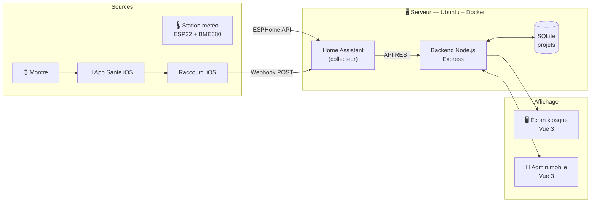
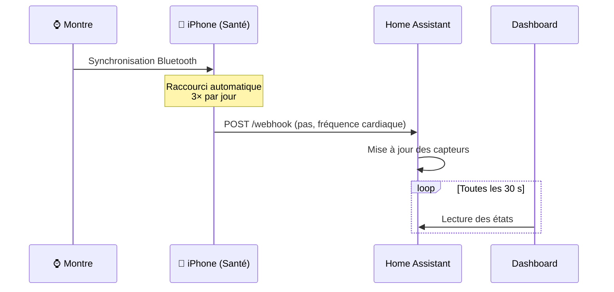

# 🧠 Home Lab — Dashboard « 2e cerveau »

Un serveur maison qui collecte les données de ma chambre (station météo, montre connectée) et les affiche, avec le suivi de mes projets perso, sur un écran toujours allumé.

Le serveur est un **vieux portable recyclé**, l'électronique est **faite à la main** et le dashboard est **développé de A à Z**, du firmware jusqu'à l'interface.


---

## ✨ Fonctionnalités

- 🌡️ **Station météo DIY** : un ESP32 et un capteur BME680 mesurent la température, l'humidité et la pression.
- ⌚ **Données santé** : la montre transmet les pas et la fréquence cardiaque via un raccourci iOS automatisé.
- 📋 **Suivi de projets** : statut, priorité, prochaine étape, et les projets inactifs depuis plus de 14 jours sont atténués à l'écran.
- 🖥️ **Mode kiosque** : le dashboard démarre seul en plein écran au boot du serveur.
- 📱 **Interface d'admin** sur le téléphone pour gérer les projets.

---

## 🏗️ Architecture



**Le principe** : Home Assistant est le **collecteur unique** et chaque capteur y devient une entité. Le dashboard a son propre backend (pattern **BFF**, *Backend for Frontend*), qui lit Home Assistant et gère les projets. Le navigateur ne parle jamais directement à Home Assistant, ce qui garde le jeton d'accès côté serveur.

### Le flux des données de la montre

Home Assistant ne peut pas lire l'iPhone : c'est donc l'iPhone qui **pousse** les données (push plutôt que pull).



---

## 🛠️ Stack technique

| Domaine | Technologies |
|---|---|
| **Frontend** | Vue 3, Vite, Vue Router |
| **Backend** | Node.js, Express, better-sqlite3 |
| **Base de données** | SQLite |
| **Infrastructure** | Docker Compose, build multi-stage, Ubuntu Server 24.04 |
| **Domotique** | Home Assistant, ESPHome |
| **Électronique** | ESP32-C3, capteur BME680 (I2C) |
| **Automatisation** | Raccourcis iOS, webhooks |

---

## 🔐 Choix de sécurité

Même sur un réseau local, j'ai appliqué de bonnes pratiques :

- **Moindre privilège** : le dashboard utilise un compte Home Assistant sans droits admin.
- **Secrets hors du code** : ils sont dans des fichiers `.env` et `secrets.yaml`, ignorés par Git et injectés au démarrage du conteneur.
- **Requêtes SQL préparées** contre les injections, et **listes blanches** pour les champs modifiables et les capteurs exposés.
- **Contraintes `CHECK`** en base : c'est la base qui refuse les valeurs invalides.
- **SSH par clé uniquement**, sans mot de passe ni accès root.
- **Webhook restreint au réseau local**, avec un identifiant aléatoire.

---

## 🚀 Lancer le projet

```bash
# Configurer les variables d'environnement
cp dashboard/backend/.env.example dashboard/backend/.env

# Démarrer tous les services
docker compose up -d --build
```

| Service | Port |
|---|---|
| Dashboard | `3000` |
| Home Assistant | `8123` |
| ESPHome | `6052` |

---

## 💡 Ce que j'ai appris

- Concevoir une **architecture en couches** (sources → collecteur → affichage) avec des responsabilités claires.
- Déboguer du **réseau et du matériel** : une carte WiFi qui se mettait en veille, la puissance d'antenne de l'ESP32, des soudures à reprendre.
- Optimiser une **image Docker** avec un build multi-stage, qui compile avec les outils de build puis livre une image finale sans eux.
- Faire tourner un **service fiable 24h/24** sur du matériel modeste (Celeron, 8 Go de RAM).

---

## 🗺️ Prochaines étapes

- [ ] Temps réel via le WebSocket de Home Assistant (au lieu du polling)
- [ ] Authentification sur l'interface d'admin
- [ ] Rubans LED et lampe connectée
- [ ] Données de sommeil et de consommation électrique
- [ ] Intégration d'un LLM local (assistant vocal)